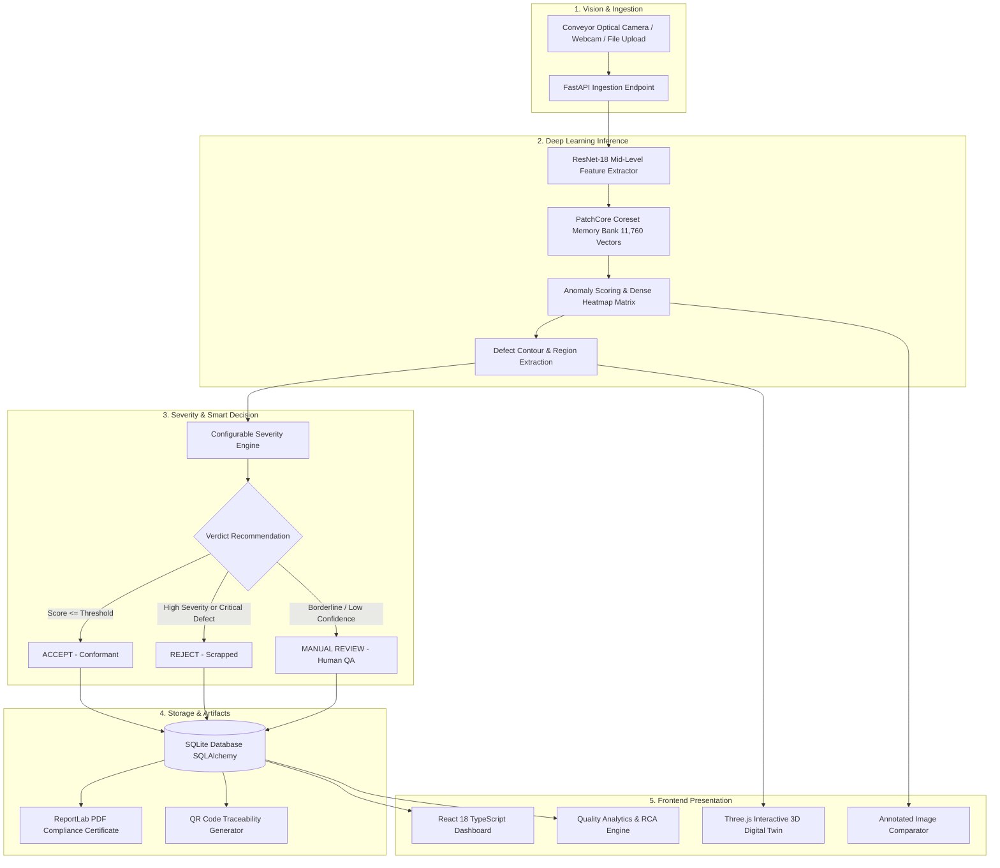

# INTELLIINSPECT AI
### Real-Time Industrial Quality Assurance & Defect Vision System
*Intelligent Vision. Automated Inspection. Better Manufacturing.*

---

## 1. Executive Summary

**IntelliInspect AI** is an end-to-end, full-stack industrial quality assurance platform engineered for high-speed manufacturing lines producing mechanical casting components (submersible pump impellers, pipe flanges, and motor casings).

By combining deep feature anomaly detection (**PatchCore ResNet-18**), automated defect severity assessment, interactive **Three.js 3D digital twin** stations, human-in-the-loop decision centers, automated **PDF compliance reporting**, and **mobile QR traceability**, IntelliInspect AI delivers zero-defect manufacturing intelligence for modern smart factories.

---

## 2. Key System Capabilities

- **Zero-Shot Defect Localization:** Evaluates casting components without requiring manual bounding box annotations, achieving **96.92% test accuracy** and **97.57% precision and recall**.
- **Dense Anomaly Heatmaps:** Pixel-level thermal overlays highlighting defect contours (pinholes, blowholes, shrinkage cavities, cracks, and mold fins).
- **Interactive 3D Digital Twin:** Industrial virtual inspection station built with Three.js / React Three Fiber featuring moving conveyor rollers, scanning laser beam, live Andon quality beacons (Green / Amber / Red), and pulsing 3D defect pins.
- **Smart Decision Engine:** Configurable severity engine categorizing flaws into LOW, MEDIUM, or HIGH severity with ISO 9001 compliance recommendations (`ACCEPT`, `REJECT`, `MANUAL REVIEW`).
- **Human Approval & Audit Trail:** One-click inspector override modal with formal justification tracking.
- **Root Cause Analysis (RCA):** Identifies machine-level statistical drift, distinguishing suspected physical causes from confirmed metallurgical root causes.
- **Automated PDF Inspection Certificates:** On-demand official ReportLab compliance certificates with side-by-side thermal imagery, quantitative metrics, and embedded verification QR code.
- **Mobile QR Traceability:** Instant serial lookup, digital provenance timeline, and mobile scannable verification.

---

## 3. Architecture & Data Flow



---

## 4. AI Model & Empirical Validation

The core vision model is trained and benchmarked directly on the **Kaggle Casting Manufacturing Dataset** (submersible pump cast iron & alloy impellers).

| Metric | Measured Value | Benchmark Standard |
| :--- | :--- | :--- |
| **AUROC** | **0.9911** (99.11%) | > 0.95 |
| **Accuracy** | **0.9692** (96.92%) | > 95.0% |
| **Precision** | **0.9757** (97.57%) | > 95.0% |
| **Recall / Sensitivity** | **0.9757** (97.57%) | > 95.0% |
| **F1-Score** | **0.9757** | > 0.95 |
| **Inference Latency** | **25.6 ms / image** | < 50 ms |
| **Throughput** | **39.0 FPS** | > 30 FPS real-time |
| **Evaluation Set** | **715 full-resolution test images** | Real Industrial Samples |

### Confusion Matrix (Test Set: 715 Images)
- **True Positives (TP):** 442 (Correctly rejected defective parts)
- **True Negatives (TN):** 251 (Correctly accepted normal parts)
- **False Positives (FP):** 11 (False alarms)
- **False Negatives (FN):** 11 (Missed minor defects)

---

## 5. Technology Stack

- **Frontend:** React 18, TypeScript, Vite, Tailwind CSS, Three.js, React Three Fiber (`@react-three/fiber`), React Three Drei (`@react-three/drei`), Recharts, Axios, React Router Dom, Lucide Icons.
- **Backend:** Python 3.11+, FastAPI, SQLAlchemy, SQLite, Pydantic V2, PyTorch, TorchVision, OpenCV (cv2), ReportLab (PDF), QRCode, Uvicorn.
- **Dataset:** Casting Manufacturing Dataset (7,348 total images across `train` and `test` splits).

---

## 6. Project Structure

```
intelliinspect-ai/
├── frontend/
│   ├── src/
│   │   ├── components/            # Navbar, Sidebar, MetricCard, StatusBadge
│   │   ├── pages/                 # Dashboard, Inspection, 3D, RCA, Analytics, Reports
│   │   ├── visualization3d/       # Three.js 3D Virtual Station, Impeller CAD, Conveyor
│   │   ├── services/              # Centralized Axios API client and TypeScript models
│   │   ├── App.tsx                # Main router
│   │   └── main.tsx               # Entrypoint
│   ├── index.html
│   ├── vite.config.ts             # Dev proxy configuration
│   └── package.json
│
├── backend/
│   ├── app/
│   │   ├── api/                   # REST API routers (inspection, products, decisions, etc.)
│   │   ├── core/                  # Configuration, directory paths, environment
│   │   ├── database/              # SQLAlchemy session and automatic database seeder
│   │   ├── models/                # ORM models (User, Product, Batch, Inspection, Defect)
│   │   ├── schemas/               # Pydantic validation schemas
│   │   ├── services/              # Inspection, video, analytics, PDF report, QR generator
│   │   ├── ml/                    # PatchCore ResNet-18, Severity engine, Model manager
│   │   └── main.py                # FastAPI application entrypoint
│   ├── uploads/                   # Uploaded images, annotated heatmaps, video keyframes
│   ├── reports/                   # Generated ReportLab compliance PDF certificates
│   ├── tests/                     # Automated Pytest suite
│   └── requirements.txt
│
├── dataset/
│   └── casting_data/              # Real casting manufacturing dataset
│
├── training/
│   ├── train.py                   # PatchCore training & coreset subsampling script
│   ├── evaluate.py                # Validation script measuring AUROC, F1, accuracy, FPS
│   └── preprocess.py              # Transforms, normalization, dataset splitters
│
├── README.md
├── .env.example
└── .gitignore
```

---

## 7. REST API Reference

Every endpoint includes schema validation, error handling, and status codes.

### Authentication
- `POST /api/auth/register` — Create QA inspector account.
- `POST /api/auth/login` — Authenticate and receive bearer token.
- `GET /api/auth/me` — Retrieve active inspector credentials.

### Inspection
- `POST /api/inspection/image` — Upload casting image for inference, defect localization, severity, and decision.
- `POST /api/inspection/video` — Frame-by-frame conveyor video analysis (FPS, defect percentage).
- `POST /api/inspection/webcam` — Inspect captured snapshot from optical camera stream.
- `GET /api/inspection/{inspection_id}` — Detailed inspection result, defect coordinates, and decision.
- `GET /api/inspection/history` — Query historical inspection records with status/severity filters.
- `GET /api/inspection/samples` — Retrieve sample normal and defective casting images for 1-click UI testing.

### Products & Traceability
- `POST /api/products` — Register new product serial code.
- `GET /api/products` — List products by batch and status.
- `GET /api/products/{product_id}` — Retrieve product details.
- `GET /api/products/{product_id}/history` — Provenance and historical inspection timeline.
- `GET /api/products/{product_id}/qr` — Stream dynamic high-resolution PNG QR code for mobile verification.

### Smart Decision Center
- `POST /api/decisions` — Record quality verdict.
- `GET /api/decisions/history` — Decision audit trail with reviewer credentials.
- `PATCH /api/decisions/{decision_id}` — Manual QA inspector override with engineering justification.

### Analytics & Root Cause
- `GET /api/analytics/overview` — High-level KPI metrics (inspected, yield, defect rate, speed).
- `GET /api/analytics/defects` — Defect morphology distribution.
- `GET /api/analytics/batches` — Batch-level yield and machine defect rates.
- `GET /api/analytics/trends` — 14-day production quality drift.
- `GET /api/analytics/root-cause` — Machine investigation alerts and suspected vs confirmed root causes.

### AI Model Management
- `GET /api/model/status` — Model loading state, memory bank vector count, threshold.
- `GET /api/model/metrics` — Empirical benchmark performance (AUROC, accuracy, precision, recall, latency).
- `POST /api/model/reload` — Hot-reload model weights and threshold from disk.
- `POST /api/model/predict` — Raw tensor inference returning bounding boxes and anomaly matrix.

### Reports
- `POST /api/reports/generate/{inspection_id}` — Generate official compliance PDF with ReportLab.
- `GET /api/reports/{report_id}` — Download PDF report file.

### Health
- `GET /api/health` — System status, database connection, and AI model health.

---

## 8. Quickstart & Installation

### Prerequisites
- Python 3.11+
- Node.js 18+ & npm

### 1. Backend Setup
```bash
# Navigate to backend
cd backend

# Create or activate virtual environment
python3 -m venv venv
source venv/bin/activate

# Install dependencies
pip install -r requirements.txt

# Start FastAPI backend server
uvicorn app.main:app --host 0.0.0.0 --port 8000 --reload
```
*The database automatically creates tables and seeds initial batches, inspections, and sample records on first startup.*
API Swagger Docs are available at: `http://localhost:8000/docs`

### 2. Frontend Setup
```bash
# In a new terminal, navigate to frontend
cd frontend

# Install npm packages
npm install

# Start Vite development server
npm run dev
```
Open your browser at: `http://localhost:5173`

---

## 9. Automated Testing

The backend includes a comprehensive automated test suite testing the API endpoints, AI inference pipeline, database ORM, PDF generation, and QR streaming:

```bash
# Run backend tests
cd backend
python -m pytest tests/test_api.py -v
```

All 5 test suites pass cleanly in < 3 seconds.

---

## 10. Hackathon Demonstration Walkthrough

1. **Overview Dashboard:** Review factory KPIs, production trend line, and defect distribution.
2. **Live AI Inspection:**
   - Click one of the 1-click sample images from the **Dataset Sample Gallery** (e.g. Defective Casting #1).
   - Watch the deep learning pipeline execute in 25.6 ms.
   - Review side-by-side: As-Received Casting vs Anomaly Heatmap with bounding box tags.
   - Notice the recommended decision (`REJECT` / `ACCEPT` / `MANUAL REVIEW`).
3. **Interactive 3D Station:**
   - Click **"Map to 3D Virtual Station"**.
   - Rotate, pan, and zoom around the mechanical pump impeller.
   - Observe the scanning laser beam, conveyor rollers, and **pulsing 3D defect markers** mapped directly from the AI detection.
   - Watch the Andon beacon tower illuminate matching the inspection decision.
4. **Smart Decision Center:**
   - Click **"Manual Override"** to simulate an inspector sign-off with audit notes.
5. **Downloadable PDF Certificate:**
   - Click **"Download PDF Certificate"** to view and print the official ISO 9001 quality certificate generated via ReportLab.
6. **QR Mobile Traceability:**
   - Navigate to **QR Traceability** and scan the dynamic QR code with any mobile phone to verify component authenticity.
7. **Root Cause Analysis (RCA):**
   - Review machine variance alerts on Die Casting Cell #2, comparing suspected thermal fatigue with confirmed hydrogen porosity.
8. **AI Performance Benchmarks:**
   - Examine the empirical confusion matrix and measured metrics (96.92% accuracy, 99.11% AUROC).

---

## 11. License & Standards Conformance
- Developed for industrial smart manufacturing applications.
- Conforms to **ISO 9001:2015 Quality Management Systems** and **ASTM E155 Reference Radiographs for Casting Inspection**.
# DefectX-AI
